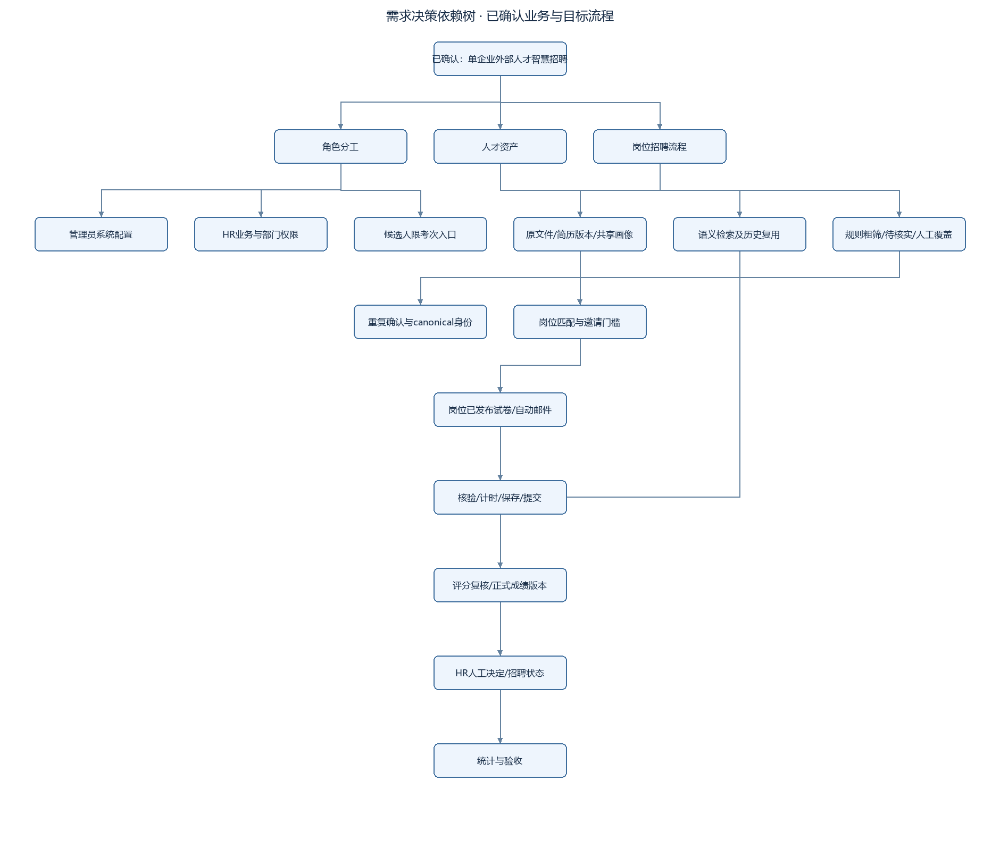

# Grill-me需求自审与决策记录

日期：2026-11-04｜方式：沿决策依赖树分轮自问，先核查事实，再检查流程/状态/权限/异常，修正文档。用户已授权本轮自行推敲，不重复打断询问细节；未确认的设计方案标D，交本轮文档总评审。

采用本地grill-me→grilling技能的方法；用户明确要求“拷打自己”，因此将原本面向用户的逐题访谈改成内部审查，不将自行回答冒充用户确认。只读环境核查与交叉审查有独立检查协助；不替用户批准技术设计。发现find-skills本地技能，但现有技能已足够，本轮没有安装额外技能/依赖。

## 1. 决策依赖树

[查看SVG矢量图](assets/diagrams/requirements-tree.svg)

查看可编辑 Mermaid 图源

~~~mermaid
flowchart TB
  A[已确认：单企业外部人才智慧招聘] --> B[角色分工]
  A --> C[人才资产]
  A --> D[岗位招聘流程]
  B --> B1[管理员系统配置]
  B --> B2[HR业务与部门权限]
  B --> B3[候选人限考次入口]
  C --> C1[原文件/简历版本/共享画像]
  C1 --> C2[重复确认与canonical身份]
  C --> C3[语义检索及历史复用]
  D --> D1[规则粗筛/待核实/人工覆盖]
  D1 --> D2[岗位匹配与邀请门槛]
  D2 --> D3[岗位已发布试卷/自动邮件]
  D3 --> D4[核验/计时/保存/提交]
  D4 --> D5[评分复核/正式成绩版本]
  D5 --> D6[HR人工决定/招聘状态]
  D6 --> E[统计与验收]
  C3 --> E
~~~

## 2. 聊天确认追踪

| 问题 | 最终确认 |
|---|---|
| Q1/Q4 | 管理员只做平台配置；HR做招聘，同一平台按角色显示菜单 |
| Q2 | 全部外部人才 |
| Q3 | 智慧招聘核心，简历筛选、人才库、画像必有 |
| Q5/Q8 | 按岗位硬条件粗筛，画像匹配结合考试成绩由HR精筛 |
| Q6 | 成功解析者入库，岗位失败不全局删除；人才与岗位应聘关系分开 |
| Q7/Q28 | 画像有事实与证据、允许修正，持续呈现考试和评价 |
| Q9/Q10 | 缺失/不确定待人工核实；HR有理由可继续推进 |
| Q11/Q13 | 暂定自动邀考：粗筛通过＋岗位画像匹配达到邀请线 |
| Q12/Q27 | 独立候选人考试入口，只展示说明/答卷/提交状态 |
| Q14 | 按投递或HR导入指定岗位处理，跨岗推荐不自动群发 |
| Q15/Q21 | 在线笔试；客观自动分，主观AI辅助后HR复核，匹配分与考试分分列 |
| Q16 | HR确认发布岗位试卷，AI辅助出题；无可用卷不发 |
| Q17/Q18 | 邮件邀请，邮箱必填；缺邮箱可留文件但补齐前不进自动流程 |
| Q19 | 各岗位自动邀请默认关，HR确认前置后开启并可暂停 |
| Q20 | 邀请有效期和答题时长分开，自动保存和超时提交，HR可重新邀请 |
| Q22 | 手工跟踪面试/拟录用/录用/拒绝/放弃，不自动发Offer或办入职 |
| Q23 | 简历由HR导入 |
| Q24/Q25/Q26 | 历史人才复用、疑似重复人工合并、保留版本；改条件/资料需显式重评，不重复邀考 |
| Q29/Q30 | 知识库优先支撑招聘；本期统计看板，智能问数后续 |
| Q31/Q32 | 单企业；固定AI流程可配置，通用拖拽编排延期 |
| 前置培训确认 | 智能培训只保留框架，不做执行功能 |

## 3. 第一轮：范围与事实挑战

| 自问 | 自答/处理 | 状态 |
|---|---|---|
| 原型是管理员账号，是否意味着管理员操作招聘？ | 否，按明确角色确认拆菜单与API权限 | 已纳入01/05 |
| 旧文档说28路由已实现，能否直接接续？ | 原源码路径不存在，只有文档证据；不宣称复用已完成 | 已纳入02 |
| 本机有Docker/模型文件就能跑吗？ | 否，需引擎/服务/实际推理验证；多个依赖未监听 | V，环境门槛 |
| 原“全套组件强制”与一期简化冲突怎么办？ | 列ADR，不静默删需求；本稿建议延后Dify/Vanna/PgSQL/Neo4j及全微服务 | D，待用户整体评审 |
| “一次性跑通”能否靠文档承诺？ | 不能；用锁版本、预检、纵向闭环、恢复验证控制风险 | 已纳入03/06 |

## 4. 第二轮：流程完整性挑战

| 自问 | 自答/处理 | 状态 |
|---|---|---|
| 缺邮箱是否拒收整批？ | 单份pending_email，文件留存，其他文件继续 | 已纳入 |
| 硬条件不确定能否当失败？ | 三态，unknown待核实，不伪造0分 | 已纳入 |
| 通过筛选就是录用吗？ | 只决定邀考；最终由HR人工决定 | 已纳入 |
| 新简历/改岗位是否自动再发一份卷？ | 新评估默认manual_only，历史邀请不重复 | 已纳入 |
| 发送中暂停开关怎么办？ | worker发送前二次检查；未发cancelled，对应邀请revoked；不能收回已发邮件 | 已纳入 |
| SMTP超时是否直接重试？ | unknown需核对，业务幂等不等于外部邮件恰好一次 | 已纳入 |
| 关闭浏览器后超时如何交卷？ | MySQL截止时间＋服务端调度，不依赖浏览器 | 已纳入 |
| 空白题会不会不计入成绩？ | start建立全题答案行，未答确定性0；finalize对照冻结题目全集 | 自审修正 |

## 5. 第三轮：数据、权限和并发挑战

| 自问 | 自答/处理 | 状态 |
|---|---|---|
| 隐藏私有来源就能避免画像泄露？ | 不够，摘要和向量也会泄露；共享画像仅基于共享事实，岗位评价授权后附加 | 自审修正 |
| 合并直接搬人才版本和应聘记录行吗？ | 会撞唯一键并破坏来源；canonical别名保留原始归属，岗位关系主从映射，冲突先处理 | 自审修正 |
| 两个worker能否重复建考次？ | 根身份/应聘加锁＋唯一application/round＋outbox幂等 | 已纳入 |
| 复核与finalize同时执行能否分数不一致？ | 均锁同attempt；正式成绩追加不可变score_reports，新版原子汇总 | 自审修正 |
| 所有snapshot都不可变，为何evaluation有state？ | 运行头可变、完成输入输出冻结；人工覆盖追加事件，不重写历史结果 | 自审修正 |
| 管理员默认读全部简历吗？ | 否，系统权限不等于HR业务权限；运维日志脱敏 | 已纳入 |
| 向量库可以代替人才业务库吗？ | 否，关系库事实＋向量语义索引＋私有文件 | 已纳入 |
| 试卷改题是否改变历史成绩？ | 发布版本和paper_items冻结；考次引用固定版本 | 已纳入 |

## 6. 第四轮：交付与验收挑战

| 自问 | 自答/处理 | 状态 |
|---|---|---|
| 旧F1计算和5条样例能证明99%吗？ | 不能，纠正precision/recall/F1，固定样本与人工标注，分别报告 | 已纳入06 |
| “P1≥95%”还是“P0/P1全绿”？ | 本期主线与重要功能P0/P1全绿，明确统一 | D待评审 |
| 2000在线是否直接沿用为本机可验收？ | 保留生产容量目标，另提本期演示基线，不能混同 | D/V |
| 存在100多个接口是否意味着本轮开始开发？ | 否，为需求驱动接口契约；未写实现、未生成开发任务拆解 | 已纳入00 |
| 培训框架会不会被测试要求做防挂机？ | 新范围与测试矩阵明确延期，展示不得假称已开启 | 已纳入01/06 |
| 外部候选人能打开localhost吗？ | 不能，生产需要HTTPS域名和邮件PUBLIC_BASE_URL，当前未部署 | V |

## 7. 当前尚未完成的评审/验证项

业务核心已确认，不再追加细节问题。D类建议随本稿审阅：技术ADR与旧强制栈的差异；共享人才/部门私有记录边界；年龄不默认自动筛选；题型及评分细则；本期演示性能/正式质量样本口径。V类条件见02/06：环境可运行、模型质量、OCR兼容、外部邮件、HTTPS地址、压测与恢复。

本轮未部署、未外发邮件、未改动原始资料或数据库。用户认可本轮文档后，才能进入详细开发todolist阶段；没有替用户勾选“评审通过”。

## 8. 最终契约复核修正

统一开考空答案revision=0；未答主观题直接记0无需人工复核；补齐邮件修订读取/测试/激活/停用接口，发送记录保存mail_config_id；重复人才合并请求增加逐岗位主次application选择参数。以上已同步04/05/06，不遗留为开发时猜测。

## 9. 本轮文档静态校验

已检查8份Markdown文件可读取、内部文档链接存在、Mermaid围栏成对；40张表的显式FK均指向本稿已定义表；104条method+path无重复且编号连续。复核了首次答案版本、正式成绩版本、邮件配置来源和合并映射参数。该结果仅为文档结构与契约一致性检查，不代表SQL迁移、OpenAPI生成、浏览器渲染或业务运行测试通过。
